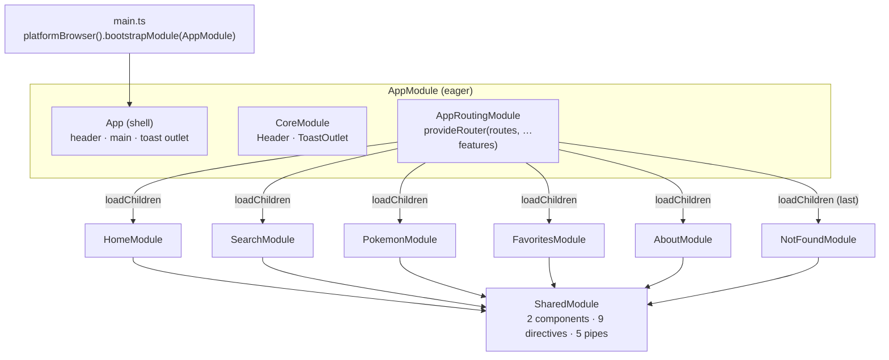
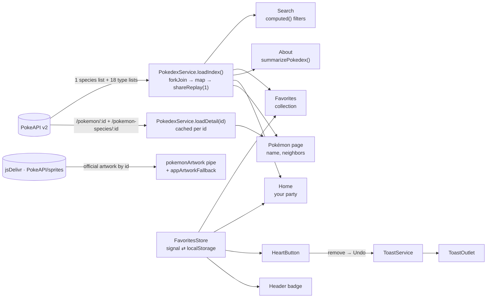

<div align="center">

# 🔴 Poké

### A National Pokédex, hand-built with Angular 22 on classic NgModules

*Search all 1,025 Pokémon, open any one of them, and collect a party of six. The codebase is meant to be read as a course: every Angular concept it uses is shown in a real feature, in context.*

[](https://angular.dev)
[](https://www.typescriptlang.org/)
[](https://rxjs.dev/)
[](https://sass-lang.com/)
[](https://vitest.dev/)
[](https://pokeapi.co/)

</div>

---

## Table of Contents

1. [What This Project Is](#1-what-this-project-is)
2. [A Tour of the App](#2-a-tour-of-the-app)
3. [Tech Stack](#3-tech-stack)
4. [Architecture](#4-architecture)
   - [4.1 Guiding principles](#41-guiding-principles)
   - [4.2 Module map](#42-module-map)
   - [4.3 Route table](#43-route-table)
   - [4.4 Data flow](#44-data-flow)
   - [4.5 Bootstrapping, step by step](#45-bootstrapping-step-by-step)
5. [Project Structure](#5-project-structure)
6. [Core: The Singleton Layer](#6-core-the-singleton-layer)
7. [Shared: The Reusable Toolkit](#7-shared-the-reusable-toolkit)
8. [Pages: Every Feature in Depth](#8-pages-every-feature-in-depth)
9. [The Design System](#9-the-design-system)
10. [Motion, Transitions & View Transitions](#10-motion-transitions--view-transitions)
    - [10.1 Dark mode](#101-dark-mode)
11. [Navigation, Focus & Accessibility](#11-navigation-focus--accessibility)
12. [State Management with Signals and RxJS](#12-state-management-with-signals-and-rxjs)
13. [Working with PokeAPI](#13-working-with-pokeapi)
14. [Testing](#14-testing)
15. [Configuration & Tooling](#15-configuration--tooling)
16. [Concept Index: Where to Learn What](#16-concept-index-where-to-learn-what)
17. [Project History: How It Grew](#17-project-history-how-it-grew)
18. [Design Decisions & Trade-offs](#18-design-decisions--trade-offs)
19. [Getting Started](#19-getting-started)
20. [Scaling the Project](#20-scaling-the-project)
21. [Roadmap](#21-roadmap)
22. [CI/CD, Contributing & License](#22-cicd-contributing--license)

---

## 1. What This Project Is

**Poké** is a complete, small application and a teaching codebase at the same time.

- **As an app,** it's a Pokédex. You search by name or number, filter by type and generation, and open a detail page with stats and flavor text. You heart the Pokémon you like and arrange the first six into a party. You can read about how the app is built, inside the app itself.
- **As a codebase,** it's a deliberately **NgModule-based** Angular 22 project (`standalone: false` everywhere). It shows how the "classic" module system and today's tools work together: signals, `linkedSignal`, the functional router features, view transitions, built-in control flow… The same tools power Angular's newest standalone apps.

Three ideas run through every file:

| Idea | In practice |
| ---- | ----------- |
| **Additive over invasive** | A new page is a new folder plus one route. A new visual pattern is one mixin. Existing code rarely has to change shape. |
| **One source of truth** | One color map for types, one design-token file, one Pokédex index, one favorites store, one toast service. |
| **Craft without dependencies** | No UI kit, no animation library, no state library. Everything is Angular, RxJS, CSS and the web platform. |

---

## 2. A Tour of the App

| Route | Page | What you can do |
| ----- | ---- | --------------- |
| `/home` | **Home** | See *your* party (your first six favorites) in a bento mosaic, followed by "Dommie's Pokémon", a hand-picked team of 16. |
| `/search` | **Pokédex** | Search 1,025 Pokémon by name (`mr mime`, `Mr. Mime` and `mr-mime` all work) or number (`25`, `#025`). Filter by up to two types and one generation, and sort four ways. Every filter lives in the URL, so a search can be shared. |
| `/pokemon/:id` | **Pokémon** | Large artwork on a stage tinted with its type colors, plus genus, flavor text, height, weight and abilities (hidden ones marked). Base stats are animated bars, and links continue into filtered searches. Previous/next navigation also works with the ← → keys. |
| `/favorites` | **Your party** | Six favorites form the **lineup**, which you reorder by drag and drop or with arrow buttons. The rest wait in **the Box**, which you filter by type and sort by recent, number or name. A "type wheel" shows your collection's mix. |
| `/about` | **About** | An editorial page: a self-drawing Poké Ball, live numbers counted from the index, an 18-color type palette, a nine-region timeline with starter silhouettes, and an interactive map of this architecture. |
| `/anything-else` | **404** | "This route fled!", with a way back. |

Small touches, everywhere:

- **Shortcuts:** <kbd>/</kbd> opens search from any page, <kbd>Esc</kbd> clears it, and <kbd>←</kbd>/<kbd>→</kbd> page through the Pokédex on a detail page.
- **Favorites:** the heart bursts in the Pokémon's type color. Removing a favorite *anywhere* shows a toast with **Undo**, and the header badge counts your favorites live.
- **Navigation:** a card's artwork morphs into the detail page through the View Transitions API. Each tab gets its own title ("Charizard #006 · Poké"), and focus moves to each new page's heading.
- **Motion and touch:** everything respects `prefers-reduced-motion`, hover effects only appear on devices that can hover, and touch targets are at least ~44px on phones.
- **Dark mode:** it follows your OS by default, and the header's sun/moon toggle switches it. The new theme spreads from the button as a growing circle, and there's never a white flash on load.

---

## 3. Tech Stack

| Layer | Technology | Version | How it's used |
| ----- | ---------- | ------- | ------------- |
| Framework | **Angular** | 22.0.5 | NgModules (`standalone: false`), signals, `linkedSignal`, router features, View Transitions, `provideAppInitializer`, `TitleStrategy` |
| Language | **TypeScript** | 6.0.3 | `noImplicitOverride`, `noImplicitReturns`, `noPropertyAccessFromIndexSignature`, `strictInjectionParameters`, `strictInputAccessModifiers` |
| Reactivity | **Angular Signals** | built-in | All component and service state |
| Async | **RxJS** | 7.8.2 | HTTP composition (`forkJoin`, `shareReplay`, `switchMap`, `catchError`), debouncing, timers |
| Interop | `@angular/core/rxjs-interop` | built-in | `toSignal`, `toObservable`, `takeUntilDestroyed` |
| HTTP | `HttpClient` + `withFetch()` | built-in | Uses the browser's Fetch API under the hood |
| Styling | **SCSS** (Dart Sass, module system) | via `@angular/build` | `@use 'poke'`, mixins, design tokens as CSS custom properties |
| Build | **@angular/build** (esbuild + Vite dev server) | 22.0.5 | `application` builder, lazy chunks, budgets |
| Unit tests | **Vitest** + **jsdom** | 4.1 / 28 | Via the `@angular/build:unit-test` builder |
| Formatting | **Prettier** | 3.8 | `printWidth: 100`, single quotes, Angular parser for HTML |
| Data | **PokeAPI** | v2 REST | Species, types, details |
| Images | **PokeAPI/sprites** via **jsDelivr** | CDN | Official artwork by Pokédex id |
| CI | **GitHub Actions** | — | Claude Code Review and Claude PR Assistant workflows |

**Not used, on purpose:** no Angular Material, Tailwind or component library; no NgRx; no animation package (`@angular/animations` isn't installed); no `zone.js`. The app runs **zoneless** and change detection is driven by signals and events.

---

## 4. Architecture

### 4.1 Guiding principles

1. **Feature isolation, fully lazy.** Every routed page is its own `NgModule` under `pages/`, loaded with `loadChildren`. `AppModule` never imports a feature, so each page ships as its own JavaScript chunk and could be deleted without touching its siblings.
2. **Core holds singletons.** `CoreModule` holds the shell UI (`Header`, `ToastOutlet`). `core/` also holds the app-wide services and routing helpers. It is imported **once**, eagerly, by `AppModule`.
3. **Shared is stateless and reusable.** Pipes, directives and small presentational components used by **two or more pages** live in `SharedModule`. They never mention a specific page.
4. **Page-local first, promote later.** A component used by one page lives in `pages/<page>/components/`. It moves to `shared/` only when a second page needs it.
5. **One design system.** Colors, radii, shadows, motion and type are tokens on `:root`. Recurring visual patterns are SCSS mixins, and a component's stylesheet holds only what is genuinely its own.
6. **Route order is load-bearing.** The router matches top-to-bottom, so the `**` wildcard is always **last**. Earlier in this repo's life it sat second and silently swallowed every navigation.
7. **The platform before a library.** IntersectionObserver, ResizeObserver, HTML5 drag & drop, `localStorage`, the View Transitions API, CSS scroll-snap and scroll-driven animations are all native.

### 4.2 Module map



`CoreModule`'s **services** (`PokedexService`, `FavoritesStore`, `ToastService`, `PokemonTransition`, `NavigationFocus`) are `providedIn: 'root'`. They're tree-shakable singletons that need no module registration. `CoreModule` only declares and exports the two shell components.

### 4.3 Route table

```ts
// src/app/app-routing-module.ts
const routes: Routes = [
  { path: '',            redirectTo: 'home', pathMatch: 'full' },
  { path: 'home',        title: 'Home',       loadChildren: () => import('./pages/home/home-module').then(m => m.HomeModule) },
  { path: 'search',      title: 'Pokédex',    loadChildren: () => import('./pages/search/search-module').then(m => m.SearchModule) },
  { path: 'pokemon/:id',                      loadChildren: () => import('./pages/pokemon/pokemon-module').then(m => m.PokemonModule) },
  { path: 'about',       title: 'About',      loadChildren: () => import('./pages/about/about-module').then(m => m.AboutModule) },
  { path: 'favorites',   title: 'Your party', loadChildren: () => import('./pages/favorites/favorites-module').then(m => m.FavoritesModule) },
  { path: '**',          title: 'Not found',  loadChildren: () => import('./pages/not-found/not-found-module').then(m => m.NotFoundModule) }, // ← ALWAYS last
];
```

The routes are registered with **`provideRouter`** inside an NgModule. That's fully supported, and it unlocks the functional router features that `RouterModule.forRoot()` can't express:

```ts
@NgModule({
  exports: [RouterModule], // directives: routerLink, routerLinkActive, <router-outlet>
  providers: [
    provideRouter(
      routes,
      withInMemoryScrolling({ scrollPositionRestoration: 'enabled', anchorScrolling: 'enabled' }),
      withViewTransitions({ skipInitialTransition: true, onViewTransitionCreated: skipSamePageTransitions }),
      withComponentInputBinding(), // :id route param → @Input() id on the detail page
    ),
    { provide: TitleStrategy, useClass: PokeTitleStrategy },
  ],
})
export class AppRoutingModule {}
```

Each feature module declares its own child routes with `path: ''`, which means "relative to the segment I was lazy-loaded under". It never needs to know its own URL.

### 4.4 Data flow



### 4.5 Bootstrapping, step by step

1. `main.ts` calls `platformBrowser().bootstrapModule(AppModule)`.
2. `AppModule` registers its providers:
   - `provideBrowserGlobalErrorListeners()`: uncaught errors and unhandled rejections reach Angular's `ErrorHandler`.
   - `provideHttpClient(withFetch())`: `HttpClient` on top of `fetch`.
   - `provideAppInitializer(() => inject(NavigationFocus).init())`: focus management starts before the first route renders.
   - `AppRoutingModule`'s providers: the router plus its features, and `PokeTitleStrategy`.
3. `App` renders the shell:
   ```html
   <app-header></app-header>
   <main class="app-main"><router-outlet/></main>
   <app-toast-outlet></app-toast-outlet>
   ```
4. The router resolves the URL, lazy-loads the matching feature chunk, and renders it into `<router-outlet>`. On the first navigation the view transition is skipped (`skipInitialTransition`), so the page simply appears.

---

## 5. Project Structure

```
poke/
├── .github/workflows/                 # Claude Code Review + Claude PR Assistant
├── public/                            # Static assets (favicon)
├── angular.json                       # Builders, budgets, schematics (standalone: false), SCSS includePaths
├── package.json
├── tsconfig.json / .app / .spec       # Compiler options; spec config adds vitest/globals types
├── .prettierrc / .editorconfig
└── src/
    ├── index.html                     # Includes the pre-paint theme script
    ├── main.ts                        # Bootstraps AppModule
    ├── styles.scss                    # Design tokens · global keyframes · view-transition rules · craft rules
    ├── styles/
    │   └── _poke.scss                 # Shared SCSS mixins → `@use 'poke'`
    └── app/
        ├── app-module.ts              # Root module + app-wide providers
        ├── app-routing-module.ts      # Routes + provideRouter features + TitleStrategy
        ├── app.ts / .html / .scss     # Shell component
        ├── app.spec.ts                # Shell tests
        │
        ├── core/                      # ── Singletons ───────────────────────────────
        │   ├── core-module.ts         # Declares/exports Header, ToastOutlet
        │   ├── components/
        │   │   ├── header/            # Sticky translucent nav, favorites badge, "/" shortcut, mobile menu
        │   │   ├── theme-toggle/      # Sun ⇄ moon switch
        │   │   ├── scroll-top/        # Back-to-top with a reading-progress ring (+ spec)
        │   │   └── toast-outlet/      # Renders the current toast with a countdown
        │   ├── models/
        │   │   ├── pokedex-entry.ts   # { id, name, types, generation }
        │   │   └── pokemon-detail.ts  # { height, weight, stats, abilities, genus, flavorText, … }
        │   ├── routing/
        │   │   ├── poke-title-strategy.ts   (+ spec)
        │   │   └── navigation-focus.ts
        │   └── services/
        │       ├── pokedex-service.ts       # Index + detail, cached
        │       ├── favorites-store.ts       (+ spec)
        │       ├── toast-service.ts         (+ spec)
        │       ├── theme-service.ts         (+ spec)  # Light / dark / system
        │       └── pokemon-transition.ts    # Which artwork morphs across routes
        │
        ├── shared/                    # ── Reusable, stateless ──────────────────────
        │   ├── shared-module.ts       # Declares + exports everything below
        │   ├── components/
        │   │   ├── heart-button/      # Favorite toggle with particle burst + undo toast
        │   │   └── state-panel/       # Every empty/error state
        │   ├── directives/
        │   │   ├── type-color-directive.ts
        │   │   ├── entrance-reveal-directive.ts
        │   │   ├── magnetic-tilt-directive.ts
        │   │   ├── artwork-fallback-directive.ts
        │   │   ├── scroll-sentinel-directive.ts
        │   │   ├── scroll-rail-directive.ts
        │   │   ├── count-up-directive.ts          (+ spec)
        │   │   └── pokemon-link-directive.ts      # PokemonLinkDirective + ArtTransitionDirective
        │   ├── pipes/
        │   │   ├── pokedex-id-pipe.ts
        │   │   ├── pokemon-name-pipe.ts
        │   │   ├── pokemon-artwork-pipe.ts
        │   │   ├── pokemon-type-color-pipe.ts
        │   │   └── stagger-pipe.ts                (+ spec)
        │   └── utils/
        │       ├── pokemon-type-colors.ts         # The 18 type colors — single source
        │       ├── pokemon-generations.ts         # 9 generations, id ranges, NATIONAL_DEX_SIZE
        │       └── pokemon-artwork.ts             # CDN URL + inline SVG fallback
        │
        └── pages/                     # ── Lazy features ────────────────────────────
            ├── home/
            │   ├── home-module.ts · home-routing-module.ts · home.ts/.html/.scss
            │   └── components/home-card/          # One bento tile
            ├── search/
            │   ├── search-module.ts · search-routing-module.ts · search.ts/.html/.scss
            │   └── components/
            │       ├── search-bar/
            │       ├── type-filter/
            │       ├── generation-filter/
            │       └── search-card/
            ├── pokemon/
            │   ├── pokemon-module.ts · pokemon-page.ts/.html/.scss
            │   ├── pokemon-neighbors.ts           (+ spec)
            │   └── components/
            │       ├── stat-bars/
            │       ├── explore-links/
            │       └── pokemon-pager/
            ├── favorites/
            │   ├── favorites-module.ts · favorites-routing-module.ts · favorites.ts/.html/.scss
            │   ├── favorites-model.ts             # PARTY_SIZE, drag payload helpers, types
            │   └── components/
            │       ├── party-grid/                # Lineup + drag & drop + move buttons
            │       ├── party-card/
            │       ├── box-card/
            │       ├── box-filters/
            │       └── collection-summary/        # The type wheel
            ├── about/
            │   ├── about-module.ts · about-routing-module.ts · about.ts/.html/.scss
            │   ├── about-stats.ts                 (+ spec)
            │   └── components/
            │       ├── about-hero/
            │       ├── stat-grid/
            │       ├── type-gallery/
            │       ├── region-timeline/
            │       └── architecture-map/
            └── not-found/
                └── not-found-module.ts · not-found.ts/.html/.scss
```

| Folder | Holds | Rule of thumb |
| ------ | ----- | ------------- |
| `src/styles.scss` | Tokens, keyframes used by many components, global "craft" rules | Add a token only when a second component needs the value |
| `src/styles/_poke.scss` | Mixins for repeated visual patterns | Add a mixin the second time you copy a pattern |
| `core/` | Shell UI, services, routing helpers | Loaded once; never imported by features |
| `shared/` | Stateless pieces used by 2+ pages | Never mentions a specific page |
| `pages/<x>/` | One routed feature | Never imports another page |
| `pages/<x>/components/` | Pieces used only by that page | Promote to `shared/` when reused |

---

## 6. Core: The Singleton Layer

### `PokedexService`: the whole Pokédex, in memory

**File:** `core/services/pokedex-service.ts`

**`loadIndex(): Observable<PokedexEntry[]>`** builds the whole index from **19 requests** instead of 1,025:

```ts
forkJoin({
  species: GET /pokemon-species?limit=1025,           // names + ids (clean species names like "mr-mime")
  types:   forkJoin(18 × GET /type/{type}),           // each lists its Pokémon with a slot (1 = primary, 2 = secondary)
}).pipe(
  map(buildIndex),                                    // id → [primary, secondary] types, generation from id range
  shareReplay({ bufferSize: 1, refCount: false }),    // fetched once per session
);
```

- **Type order.** Types are ordered by **slot**, so `types[0]` is always the primary type, which drives card colors.
- **Alternate forms are skipped.** Megas and regional forms live at ids 10001+ and are filtered out.
- **The generation** is computed from contiguous id ranges (`resolvePokemonGeneration`), with no extra request.
- **Failed loads aren't cached.** `shareReplay` doesn't replay an error, so a retry simply subscribes again.

**`loadDetail(id): Observable<PokemonDetail>`** works per Pokémon:

- It runs `forkJoin` over `/pokemon/{id}` (height, weight, stats, abilities) and `/pokemon-species/{id}` (genus, flavor text, legendary/mythical).
- It converts units: decimeters to meters, hectograms to kilograms.
- It picks the **newest English** flavor text and cleans the game-box line breaks and form feeds.
- It caches results in a `Map<number, Observable<PokemonDetail>>`, so paging back and forth never refetches.

### `FavoritesStore`: a persisted, validated, cross-tab signal store

**File:** `core/services/favorites-store.ts`. Storage key: `poke.favorites.v1`.

| API | Behavior |
| --- | -------- |
| `entries()` / `ids()` / `count()` | Read-only signals: `{ id, addedAt }[]`, the ids, and the count |
| `has(id)` | O(1) via a computed `Set` |
| `add(id)` / `remove(id)` / `toggle(id)` | Validated mutations, persisted to `localStorage` |
| `moveTo(id, index)` | Reorders (clamped). The **array order is the arrangement**: the first 6 are the party |
| `undoRemove()` / `dismissUndo()` / `lastRemoved()` | Remembers the last removal and its index, so it can be restored exactly where it was |
| `clear()` | Empties the collection |

- **Defensive reads.** Storage is user-editable and may come from older versions, so `readFavorites()` drops invalid ids (outside 1–1025, non-integers, non-numbers), removes duplicates, accepts bare numbers (legacy format), and recovers from invalid JSON.
- **Safe writes.** Every write is wrapped in `try/catch`, so favorites still work in private mode for the current visit.
- **Cross-tab sync.** The store listens to the `storage` event and adopts changes made in another tab, so two open tabs never overwrite each other with stale copies.

### `ToastService` and `ToastOutlet`: one voice for feedback

**Files:** `core/services/toast-service.ts`, `core/components/toast-outlet/`

- **One toast at a time.** `show({ message, actionLabel?, action?, dismissed?, duration? })` shows a toast, and a **new toast replaces the current one** (dismissing it). If you un-heart three Pokémon quickly, the latest undo is the one offered.
- **Actions.** `runAction()` runs the action once, and that doesn't count as a dismissal. `dismiss()` calls `dismissed` and is also called by the auto-timer (5 s by default).
- **Rendering.** The outlet sits in the shell as an `aria-live="polite"` region. A red line at the bottom shrinks over the toast's lifetime: the undo window, visibly running out. Each toast is rendered through a one-item `*ngFor` keyed by id, so every new toast restarts its entrance and countdown animations.

### `ThemeService` and `ThemeToggle`: light, dark or the OS

**Files:** `core/services/theme-service.ts`, `core/components/theme-toggle/`. Storage key: `poke.theme.v1`.

| API | Behavior |
| --- | -------- |
| `preference()` | `'light' \| 'dark' \| 'system'` (a read-only signal) |
| `theme()` / `isDark()` | The resolved theme. With `'system'` it follows `prefers-color-scheme` **live** |
| `toggle(origin?)` | Flips light ⇄ dark. If the result matches the OS, it stores `'system'`, so the app quietly goes back to following the OS. That's why there's no separate "use system setting" control |
| `setPreference(p, origin?)` | Sets, persists and applies a preference |

- **How a theme is applied.** The theme is written as `<html data-theme="light|dark">` and every `meta[name="theme-color"]` is updated (the address-bar color on mobile). That's all the CSS needs, because every color in the app is a token the dark palette redefines.
- **No flash on load.** `index.html` runs a few lines of inline script **before Angular boots** that apply the saved theme (or the OS one), so a dark-mode visitor never sees a white flash. Without JavaScript, CSS falls back to `@media (prefers-color-scheme: dark)`.
- **Sync and resilience.**
  - Changes in another tab arrive through the `storage` event.
  - Changes to the OS setting arrive through a `matchMedia` listener.
  - Storage access is wrapped in `try/catch`.
- **The reveal.** `ThemeToggle` passes the button's center to `toggle()`. Inside `document.startViewTransition()`, the new theme grows from that point as a `clip-path: circle()`, sized to reach the farthest corner of the viewport. The DOM update runs **synchronously** inside the transition callback (not in an `effect`), because the "after" snapshot is taken right when the callback returns. During the switch, the header drops its own `view-transition-name`, so it's revealed along with the page.
- **The toggle.** A sun whose core swells while a shadow disc slides in to carve a crescent, and whose rays fold away with a quarter turn. It's all transforms, so it's smooth and interruptible. It's a `role="switch"` with `aria-checked` and a contextual `title`.

### `ScrollTop`: back to the top, with a reading ring

**Files:** `core/components/scroll-top/` (`scroll-state.ts` holds the pure logic, with a spec).

- **When it shows.** It appears once you've scrolled past most of a screen, and only on pages long enough to need it. It rises in from slightly below and hides again near the top.
- **The ring.** A red arc (`pathLength="1"` + `stroke-dashoffset`) shows how much of the page you've read, starting at twelve o'clock. At the very bottom the ring closes and the arrow turns red.
- **On click.** It scrolls smoothly to the top (instantly under reduced motion) and focuses the page's `<h1>`, so keyboard and screen-reader users land where sighted users do.
- **Performance.** Scroll and resize are measured at most once per frame (`requestAnimationFrame`) with passive listeners.
- **On phones,** it steps up while a toast is showing (`body:has(.toast)`), so the two never overlap.

### `PokemonTransition`: which artwork morphs

**File:** `core/services/pokemon-transition.ts`

A `view-transition-name` must be unique on the page, so only **one** card's artwork can carry the shared name `pokemon-art`.

- `activeId` (a signal) records the Pokémon being opened, or the one being returned to.
- After landing back on a list page, it's cleared after 1 s. Otherwise the same Pokémon on the *next* page (Home after Search) would morph too.

### `PokeTitleStrategy`: tab titles

**File:** `core/routing/poke-title-strategy.ts`

- **Format.** It extends `TitleStrategy` and formats titles as `"{page} · Poké"`, page first, so a row of tabs stays easy to tell apart.
- **Pages that title themselves.** When the deepest route has `data: { pageOwnsTitle: true }` (the detail page), the strategy steps aside and the page sets `"Charizard #006 · Poké"` itself once its data loads.

### `NavigationFocus`: focus that follows the page

**File:** `core/routing/navigation-focus.ts`

- **What it does.** After a **path** change (not a query-string change), it waits one animation frame and focuses the new page's `<h1>`, adding `tabindex="-1"` when needed. That's what a screen reader would get from a full page load.
- **When it leaves focus alone:**
  - On first load.
  - On filter changes.
  - When the new page already focused something on purpose (the search field after <kbd>/</kbd>).
- **Anchors.** It also sets `ViewportScroller.setOffset([0, 72])`, so anchor scrolling lands below the sticky header.

### `Header`

**File:** `core/components/header/`

- **Appearance.** A sticky, translucent bar (`color-mix` + `backdrop-filter`). It spans the full width while its content aligns to the page column.
- **Navigation.**
  - `routerLink` + `routerLinkActive` for Home, Pokédex, Favorites and About.
  - **Pokédex** uses `exact: false`, so it stays lit on filtered searches (`/search?types=fire`).
  - An extra `inPokedex` signal (`toSignal` over `NavigationEnd`) keeps it lit on `/pokemon/:id` too.
- **Favorites badge.** It's rendered through `*ngFor="let count of [favorites.count()]"`. The one-item array is a trick: a new value recreates the element, which replays its "pop" animation.
- **Shortcut.** <kbd>/</kbd> navigates to `/search` with `state: { focusSearch: true }`, ignoring keystrokes typed into inputs.
- **Mobile.** A hamburger toggles the menu with an `isMenuOpen` signal. It also has its own `view-transition-name: site-header`, so it **never cross-fades** between routes.

### Models

```ts
interface PokedexEntry  { id: number; name: string; types: string[]; generation: number; }
interface PokemonDetail { id; height /* m */; weight /* kg */; stats: { name; value }[];
                          abilities: { name; hidden }[]; genus; flavorText; legendary; mythical; }
```

---

## 7. Shared: The Reusable Toolkit

`SharedModule` imports `CommonModule` and `RouterModule`, and **declares and exports** everything below. Every feature imports it.

### 7.1 Components

#### `<app-heart-button>`

```html
<app-heart-button [pokemonId]="pokemon.id" [label]="pokemon.name | pokemonName" [type]="pokemon.types[0]"></app-heart-button>
```

- **No state of its own.** It reads and writes `FavoritesStore`, so the same Pokémon's heart is in sync on every page and in every tab.
- **Adding.** The heart pops, a ring expands, and **8 sparks** fly out along evenly spaced spokes (`rotate(calc(var(--p) * 45deg))`). The sparks alternate Poké Ball red with the Pokémon's own type color (via `appTypeColor` → `--accent`). The burst element is keyed in `*ngFor`, so each click restarts the animation from frame zero.
- **Removing.** It raises a toast: "Pikachu left your favorites." with **Undo**.
- **Placement.** It's absolutely positioned in a card's top-left corner (every card is `position: relative`) and sits at `z-index: 2`, above the card's stretched link.
- **Touch.** It looks 34px, but on coarse pointers it gets a ~44px invisible hit area. It has `aria-pressed`, a contextual `aria-label`, and a `title` for hover users.

#### `<app-state-panel>`

```html
<app-state-panel heading="No wild Pokémon appeared" text="…" actionLabel="Clear filters" (action)="clearAll()"></app-state-panel>
<app-state-panel heading="Your party is empty" motion="float" actionLabel="Explore the Pokédex" actionLink="/search">
  <!-- projected content: suggestions -->
</app-state-panel>
```

- **One shape for every empty or error state:** a line-drawn Poké Ball, a heading, one sentence and **at most one next step**.
- **Inputs:**
  - `tone` (`empty` | `error`; errors get `role="alert"` and a red-tinted ball).
  - `motion` (`wobble` | `float` | `none`).
  - `actionLink`: when set, the action renders as a link; otherwise it's a button that emits `(action)`.
- **Content projection.** `<ng-content>` places extras (Favorites' suggestions, 404's "or head home") between the text and the action.

### 7.2 Directives

| Directive | Selector | Kind | What it does | How |
| --------- | -------- | ---- | ------------ | --- |
| `TypeColorDirective` | `[appTypeColor]` + `appTypeColorMode` | Attribute | Turns a type into `--accent` (mode `accent`) or a solid `background` (mode `fill`) | `@HostBinding` getters calling `resolvePokemonTypeColor()` |
| `EntranceRevealDirective` | `appEntranceReveal` | Attribute | Adds `.pending-reveal`, which triggers the `bloom` keyframes (grayscale → color) | `@HostBinding('class.pending-reveal')`. The animation is pure CSS, so it can't race the first paint |
| `MagneticTiltDirective` | `[appMagneticTilt]` | Attribute | Tilts up to 4° and moves a light glow with the pointer | `ElementRef.getBoundingClientRect()` → `--tilt-x/y`, `--glow-x/y` host style bindings. Gated by `(hover: hover) and (pointer: fine)` and reduced motion. Listens to `matchMedia` changes |
| `ArtworkFallbackDirective` | `img[appArtworkFallback]` | Attribute | Retries a failed CDN image once (cache-busted, after 600 ms), then swaps in an inline SVG Poké Ball | `@HostListener('error')` |
| `ScrollSentinelDirective` | `(appScrollSentinel)` | Attribute + output | Emits when the host is within 600 px of the viewport, for infinite lists | `IntersectionObserver`. It re-observes after each emit, because the observer only reports *changes* |
| `ScrollRailDirective` | `appScrollRail` · `#rail="scrollRail"` | Attribute + `exportAs` | Exposes `canScrollStart()`/`canScrollEnd()` signals and `scrollByPage(±1)` | `@HostListener('scroll')` + `ResizeObserver`, with a 1 px tolerance for fractional widths |
| `CountUpDirective` | `[appCountUp]` (+ `appCountUpDuration`) | Attribute | Counts the host's number from 0 to its value the first time it's 60% visible, easing out (cubic) | `IntersectionObserver` + `requestAnimationFrame`. Shows the final value immediately without IO or under reduced motion; later changes are written straight through |
| `PokemonLinkDirective` | `a[appPokemonLink]` | Attribute | Marks which Pokémon is being opened | `@HostListener('click')` → `PokemonTransition.mark(id)` |
| `ArtTransitionDirective` | `img[appArtTransition]` | Attribute | Claims `view-transition-name: pokemon-art` only while its Pokémon is the active one | `@HostBinding('style.view-transition-name')` reading a signal |

> **When is something a directive?** When it needs a real DOM node: geometry, observers, events, focus. A value that only needs formatting is a **pipe**. A visual style is a **mixin**.

### 7.3 Pipes (all pure)

| Pipe | Example | Notes |
| ---- | ------- | ----- |
| `pokedexId` | `25 \| pokedexId` → `#025` | Optional digit count |
| `pokemonName` | `mr-mime` → `Mr. Mime`, `ho-oh` → `Ho-Oh`, `iron-treads` → `Iron Treads`, `nidoran-f` → `Nidoran♀` | A special-names table plus a set of genuinely hyphenated names |
| `pokemonArtwork` | `25 \| pokemonArtwork` → jsDelivr URL | `https://cdn.jsdelivr.net/gh/PokeAPI/sprites@master/sprites/pokemon/other/official-artwork/25.png` |
| `pokemonTypeColor` | `'electric' \| pokemonTypeColor` → `#f8d030` | Used for `--accent-2` (secondary type) bindings |
| `stagger` | `i \| stagger: 30` → `min(i, 12) × 30` ms | Caps entrance delays so long lists don't make the last item wait seconds |

**Why pipes and not methods?** A template method call (`{{ format(x) }}`) re-runs on **every** change-detection pass. A pure pipe only recomputes when its input changes.

### 7.4 Utils: single sources of truth

- **`pokemon-type-colors.ts`.** `POKEMON_TYPE_COLORS` maps the 18 types to their colors, and `resolvePokemonTypeColor(type)` falls back to `normal`. The pipe, the directive, the type wheel, the About palette and the hero ring all read from it.
- **`pokemon-generations.ts`.** `POKEMON_GENERATIONS` lists Kanto to Paldea with numerals and id ranges (`1–151` … `906–1025`). It also exports `NATIONAL_DEX_SIZE` (1025) and `resolvePokemonGeneration(id)`.
- **`pokemon-artwork.ts`.** `pokemonArtwork(id)` builds the CDN URL, and `FALLBACK_ARTWORK` is an inline SVG data URI that never touches the network. jsDelivr is used instead of `raw.githubusercontent.com` because GitHub rate-limits and resets hotlinked connections.

---

## 8. Pages: Every Feature in Depth

### 8.1 Home: `/home`

**Concepts:** CSS Grid dense packing, data-driven layout, component extraction, conditional sections.

- **Bento mosaic.**
  - A 4-column grid (`grid-auto-rows: 150px; grid-auto-flow: dense`).
  - Each item's **size comes from data**: `bento: 'hero' | 'wide' | 'tall' | 'regular'`. The grid maps it to spans (`hero` 2×2, `wide` 2×1, `tall`/`regular` 1×2).
  - Adding a Pokémon is one object in an array, never a template edit.
- **Your party.** If you have favorites, Home loads the index and shows your first six above Dommie's team. A lookup table, `PARTY_LAYOUTS`, picks bento shapes per party size so **every size from 1 to 6 tiles the grid without holes** (a full party opens and closes with a hero cell).
- **`HomeCard`** (`pages/home/components/home-card`) is one tile. The grid decides *where* a tile sits; the tile decides *how* its portrait and text arrange inside (row layout for `wide`, a zoom-in for `hero` on hover, an ease-*back* for `tall`, "like stepping away from a painting").
  - `hero` and `wide` tiles get `appMagneticTilt`: a perspective tilt plus a cursor-follow glow.
  - Every tile has `appEntranceReveal`, with a staggered delay (`index | stagger: 45`) and an alternating left/right settle (`--enter-shift`).
  - The primary type badge gets a whisper of emphasis (`scale(1.08)` and a shadow).
- **Responsive.** 4 columns, then 2 at ≤900 px, then 1 at ≤560 px. In one column, tiles drop their row spans and the artwork takes its shape from `aspect-ratio`.

### 8.2 Pokédex: `/search`

**Concepts:** `computed` derivations, `linkedSignal`, URL as state, `toObservable` + `debounceTime`, faceted counts, infinite scroll, presentational vs. container components.

**Container: `Search`** (`search.ts`) owns all state as signals: `query`, `types`, `generation`, `sort`, `status`.

| Signal | Purpose |
| ------ | ------- |
| `queryMatcher` | A `computed` that returns a **function**. A numeric query matches the exact id *or* a zero-padded id prefix (`#02` → 020–029). A text query matches a normalized name (`"Mr. Mime"` → `mrmime`, accents stripped via `normalize('NFD')`). |
| `matchingQueryAndGeneration` | The shared base for the results and the type facets |
| `results` | Filtered by up to 2 types (**AND**, since a Pokémon has at most two), then sorted (`No. ↑`, `No. ↓`, `A–Z`, `Z–A`) |
| `renderLimit` | A **`linkedSignal`** that resets to 36 whenever `results` changes, so a new search starts at page one |
| `visibleResults` / `hasMore` | The slice that's actually rendered |
| `typeCounts` | For each type: how many results you'd get if you tapped it. **0 disables the chip**, so you can't walk into an empty page |
| `generationCounts` | The same for generations (key `0` = all) |
| `glowA` | The search bar's focus tint: the first selected type, or the brand red |

- **URL as state.**
  - Filters are read once from `queryParamMap` (validated: unknown types dropped, at most 2, bad `gen`/`sort` ignored).
  - They're written back **debounced** (250 ms) via `toObservable(...).pipe(skip(1), debounceTime(250))`, using `router.navigate([], { replaceUrl: true, scroll: 'manual', queryParams })`.
  - `replaceUrl` keeps history clean, and `scroll: 'manual'` means refining a search never jumps the page.
- **Infinite list.** The "Show more" button doubles as the `appScrollSentinel` host. It loads 36 more as you approach it, and it stays a real button for keyboard users.

**Presentational components** take `@Input()`s and emit `@Output()`s. They hold no business state:

| Component | Highlights |
| --------- | ---------- |
| `SearchBar` | A quiet pill input, like every other control. On focus only the edge answers: the border and the magnifier take a tint of the first selected type (or the brand red) with a thin 3px ring. A result count appears while typing. <kbd>/</kbd> focuses it, and so does arriving through the header shortcut (`history.state.focusSearch`). The first <kbd>Esc</kbd> clears, the second blurs. The native WebKit clear button is hidden in favor of its own. |
| `TypeFilter` | 18 chips inside a `<fieldset>`/`<legend>`. Selecting a chip floods it with its type color through an animated `clip-path: circle()` that grows from the dot. Each chip shows its facet count and uses `aria-pressed`. |
| `GenerationFilter` | A `role="radiogroup"` timeline of 9 regions, built on `appScrollRail`. Arrows and edge fades appear **only** on the side where more is hidden, pills snap into place, and choosing a half-hidden pill scrolls it into view. The active pill turns ink-black with a red "seam" underneath. |
| `SearchCard` | An outlined id watermark behind the art, a type-colored spotlight, and a hairline running from the primary to the secondary type. On hover the Pokémon "steps forward" while the watermark drifts the other way (parallax). The whole card links to the detail page. |

**States:** a shimmer skeleton grid, an error panel with **Try again**, and an empty panel "No wild Pokémon appeared" with **Clear filters**.

### 8.3 Pokémon detail: `/pokemon/:id`

**Concepts:** `withComponentInputBinding`, discriminated-union state, `switchMap` cancellation, per-page titles, keyboard shortcuts, shared-element transitions.

- **Route input.** `@Input() set id(value: string)` receives the `:id` param directly from the router. It validates the value (an integer between 1 and 1025, otherwise `0` = "missing") and marks the transition.
- **Detail state** is a discriminated union, `{ status: 'loading' } | { status: 'ready', detail } | { status: 'error' } | { status: 'missing' }`, built with:
  ```ts
  toObservable(computed(() => [this.pokemonId(), this.retries()] as const)).pipe(
    switchMap(([id]) => id === 0 ? of({ status: 'missing' })
      : this.pokedex.loadDetail(id).pipe(map(ready), catchError(() => of(error)), startWith(loading))),
  )
  ```
  `switchMap` cancels a slow request when you page quickly with the arrow keys. The `retries` signal powers **Try again**.
- **Layout.**
  - **The stage:** a pool of type color plus a diagonal tint of the secondary type, the id in giant outline numerals, and the artwork carrying the shared `view-transition-name`. The heart sits in the corner.
  - **The info column:**
    - An eyebrow (`#006 · Generation I · Kanto`) over a large name, then the genus ("Flame Pokémon") with **Legendary**/**Mythical** tags.
    - Type pills that link to `/search?types=…`.
    - The flavor text as a quote bordered in the type color.
    - Facts: height, weight, abilities (hidden ones marked).
- **`StatBars`.** Six bars drawn against a **shared 255 ceiling** (the highest base stat in the games), so pages can be compared by eye. They fill in the type gradient one after another (`animation-delay: i × 70 ms`), with a total row underneath.
- **`ExploreLinks`.** "More **Fire**-type Pokémon", "More **Flying**-type Pokémon", "Everyone from **Kanto**": each one a filtered search.
- **`PokemonPager`.** Previous and next with tiny portraits. `findNeighbors()` (a pure, tested function) doesn't wrap at the ends. <kbd>←</kbd>/<kbd>→</kbd> navigate unless you're typing, and a hint appears only on devices with hover.
- **Title.** An `effect()` sets `"Charizard #006 · Poké"` once the index names the Pokémon.

### 8.4 Your party: `/favorites`

**Concepts:** derived collections, HTML5 drag & drop, keyboard alternatives, setter-based `@Input`, content projection.

- **`collection`** joins `FavoritesStore.entries()` with the index, keeping the user's order. `party` is the first `PARTY_SIZE = 6`, and the rest are **the Box**.
- **`PartyGrid`** owns *all* reordering:
  - **The layout:** a 3-column lineup where slot 1 is a 2×2 "lead", the next two stack beside it, and three sit underneath.
  - **Empty slots** are dashed, hatched outlines with a Poké Ball and their number ("04 · Open slot"), and they're drop targets.
  - **HTML5 drag & drop.** A custom MIME type (`application/x-poke-id`, plus `text/plain`) lets a Box card be dropped straight onto a party slot. `dragleave` uses `relatedTarget` checks, so crossing into child elements doesn't flicker the highlight. The dragged slot fades and shrinks, and the target gets a dashed red outline.
  - **Move buttons** (‹ ›) on every member are the keyboard- and touch-friendly twin of drag & drop.
- **`PartyCard`** is purely presentational. The lead gets bigger type and a **holographic sheen**: a radial light at the tilt glow position plus a faint rainbow band, blended with `mix-blend-mode: soft-light`, like a foil card catching the light.
- **`BoxCard`** is a compact "PC box" tile with its hairline on the *bottom* edge (a quieter tier than the party). It's draggable and has a **↑ Send to party** button, which joins as the last member and, if the party is full, swaps the sixth back into the Box.
- **`BoxFilters`.** Type chips list only the types present in the Box, with counts. Sort is a segmented control: **Recent** (by `addedAt`), **No.**, **A–Z**. A type filter whose last Pokémon leaves the Box quietly resets itself (`activeBoxType`).
- **`CollectionSummary`, the type wheel.**
  - A `conic-gradient` built in TypeScript with **one arc per type, sized by its share** of all type occurrences. A white core shows the total ("12 caught").
  - It also lists types covered (x/18), your "home region" (most common generation) and a legend of the top four types.
  - It's computed in an `@Input` **setter**, so it only recomputes when the list reference changes.
- **States:** a party-shaped skeleton, an error panel, and an empty panel with **three random suggestions** (Fisher–Yates shuffle) you can heart right there. Removing anything shows the app-wide **Undo** toast.

### 8.5 About: `/about`

**Concepts:** pure functions for statistics, scroll-driven animations, SVG line drawing, `conic-gradient`, `exportAs` directives, interactive diagrams.

A red **"thread"**, the Poké Ball's seam, runs down the left edge and stitches the sections together, with a knot at each section. Section numbers sit behind each heading as huge outlined numerals.

| Section | Component | Highlights |
| ------- | --------- | ---------- |
| Hero | `AboutHero` | An SVG Poké Ball **draws itself** (`pathLength="1"` + `stroke-dashoffset`). Then its cap fills with a **slowly turning conic ring of all 18 type colors**, clipped to the top half. Two CTAs follow. |
| 01 · By the numbers | `StatGrid` | Live figures from `summarizePokedex()`: total, types, regions, dual-type count, the **most common type** (linked, in its color) and **your favorites** (live). Each number uses `appCountUp`. The layout is a 4×2 bento with a red feature tile. |
| 02 · The 18 types | `TypeGallery` | A **Swiss-style specimen sheet**: 18 cells set edge to edge, with 1px hairlines (the sheet's own color showing through 1px gaps) under a labeled ruler. Each cell has its number and hex on top, a color swatch in the middle, and the name and count at the bottom. The type's first Pokémon sits centered and whole in its swatch as a soft silhouette. On hover or focus the color floods the cell (an animated `clip-path`) and the Pokémon grows slightly into full color. It's 6 columns on wide screens and 3 on phones, and narrow cells restack the count under the name, so nothing is cut or hidden. Links go to `/search?types=…`. |
| 03 · Nine regions | `RegionTimeline` | A horizontal timeline on `appScrollRail`: numeral, region, id range, species count and the grass starter as a "Who's that Pokémon?" silhouette. Unova uses Snivy (#495), because #494 is the mythical Victini. Links go to `/search?gen=…`. It's static data, so it renders without the index. |
| 04 · How it's built | `ArchitectureMap` | `AppModule` wired to Core, Shared and Pages with SVG curves (`vector-effect: non-scaling-stroke` keeps them crisp at any width). Hovering or focusing a module lights its wire, highlights related modules (Shared ↔ Pages) and dims the rest. Four "design decision" cards sit below. |
| 05 · Credits | — | PokeAPI, PokeAPI/sprites, Angular, and a trademark notice. No official logos. |

Sections **rise in as you scroll** using `animation-timeline: view()` inside `@supports`. Browsers without support simply show everything, never hidden.

### 8.6 Not found: `**`

A giant outlined **404** sits behind "This route fled!", above a `StatePanel` ("It broke free before we could catch it.") with **Back to the Pokédex** and a quieter "or head home". It's lazy-loaded like every other page and is still the **last** route.

---

## 9. The Design System

### 9.1 Tokens (`src/styles.scss`)

```scss
:root {
  // Palette
  --poke-red: #ee1515;  --poke-red-dark: #cc0000;  --poke-blue: #3b4cca;
  --poke-ink: #1c1c1e;  --poke-gray: #6e6e73;      --poke-muted: #a1a1a6;
  --poke-border: #e5e5ea; --poke-canvas: #ffffff;  --poke-bg: #ffffff; --poke-surface: #f5f5f7; --poke-surface-hi: #fbfbfd;
  --poke-inverse: #1c1c1e; --poke-on-inverse: #fff; --poke-emphasis: #1c1c1e; --poke-on-emphasis: #fff;
  // Shape
  --radius-sm: 0.75rem; --radius-md: 1rem; --radius-lg: 1.25rem; --radius-pill: 999px;
  // Elevation
  --shadow-rest; --shadow-raised; --shadow-float; --shadow-overlay;
  // Motion
  --ease-out: cubic-bezier(0.22, 1, 0.36, 1); --ease-spring: cubic-bezier(0.16, 1, 0.3, 1);
  --dur-fast: .2s; --dur-base: .25s; --dur-slow: .5s; --dur-enter: .8s;
  // Type
  --font-sans; --font-mono; --text-xs; --text-sm; --text-md;
  --text-title: clamp(1.75rem, 1.4rem + 1.5vw, 2.5rem); --text-section: clamp(1.375rem, 1.1rem + 1vw, 1.875rem);
  // Layout
  --page-max: 1080px; --gutter: 1.5rem; /* 1rem ≤ 560px */
}
```

**Type color as data.** `appTypeColor` sets `--accent` on a card. The secondary type arrives as `--accent-2` through the `pokemonTypeColor` pipe. Everything type-tinted (hairlines, spotlights, shadows, stat bars, borders) reads these two variables, usually through **`color-mix(in srgb, var(--accent) 30%, transparent)`**.

> **A lesson in custom properties:** a token on `:root` can't reference a card's `--accent`, because `var()` inside a custom property resolves where it's *defined*. That's why accent-tinted shadows are a **mixin** (`accent-lift`), not a token.

### 9.2 Mixins (`src/styles/_poke.scss`)

`angular.json` adds `src/styles` to `stylePreprocessorOptions.includePaths`, so any component can write `@use 'poke';`.

| Group | Mixin | Purpose |
| ----- | ----- | ------- |
| Text | `eyebrow`, `page-title`, `section-title`, `lede`, `label`, `id-label`, `outline-numeral($color)` | The type scale shared by every page. `label` is the small uppercase field label ("HEIGHT", "TYPES", a legend); `id-label` is a quiet tabular reference ("#025", a hex code) |
| Surfaces | `card($radius)`, `type-hairline($edge, $height)`, `accent-lift($rise)`, `type-spotlight($strength)` | Cards and their type-colored details |
| Motion | `bloom($duration)`, `skeleton($radius)`, `hover { … }`, `reduced-motion { … }` | Entrances, placeholders, capability gates |
| Controls | `focus-ring($color, $offset)`, `button-reset`, `primary-button`, `icon-button($size, $icon)`, `touch-target($reach)`, `segmented($option)`, `type-chip-selected($dot)` | Buttons and controls |
| Rails | `rail-track($gap)`, `rail-arrow` | Horizontal scrollers with edge fades and arrows |
| Links | `stretched-link`, `card-focus($link)` | A whole card clickable through its single link, with the focus ring drawn on the card via `:has(:focus-visible)` |

### 9.3 Global keyframes

Angular **scopes** `@keyframes` declared inside a component. A pattern used by many components therefore lives globally, once:

| Keyframes | Used by |
| --------- | ------- |
| `poke-bloom` | Every card entrance. Tunable per caller with `--enter-rise`, `--enter-scale` and `--enter-shift` |
| `poke-shimmer` | Every skeleton |
| `poke-spin` | Spinners, the About hero ring |
| `poke-fade-up` | Hero copy |

### 9.4 Global craft rules

- **`::selection`** is tinted with brand red. The tap highlight is removed.
- **Text wrapping.** Headings use `text-wrap: balance` and paragraphs `text-wrap: pretty`.
- **Touch and press.** `touch-action: manipulation` on controls removes the double-tap zoom delay. A **tactile press** (`:active { scale: 0.96 }`) uses the individual `scale` property, so it **composes** with any `transform` a component already applies.
- **Focus.** A baseline `:focus-visible` ring that components refine with their own color.

### 9.5 Layout

- **Width and gutters.** `.app-main` owns horizontal gutters, and every page centers its content at `--page-max`.
- **Header.** It spans the full width, but its padding `max(var(--gutter), (100% - var(--page-max)) / 2)` aligns its content with the page column.

### 9.6 Budgets

Each component stylesheet is limited to **4 kB warning / 8 kB error** (and the initial bundle to 500 kB / 1 MB). When a stylesheet grows past that, it's **split into subcomponents** (that's how `HomeCard`, `PokemonPager`, `ExploreLinks` and the party grid's move buttons came to be) rather than trimmed in quality.

---

## 10. Motion, Transitions & View Transitions

**Principles**

1. **Two curves, four durations.** `--ease-out` for things settling, `--ease-spring` for things responding. No decorative animation lasts longer than `--dur-enter` (0.8 s).
2. **Keyframes for entrances, transitions for interactions.** A keyframe animation plays the instant its class exists. A transition needs a painted "before" state and can lose that race against bootstrap.
3. **Staggers are capped** (`stagger` pipe, max 12 steps).
4. **Hover only where hover exists**: `@media (hover: hover) and (pointer: fine)`.
5. **Everything degrades** under `prefers-reduced-motion`, including route transitions and scroll-driven animations.
6. **Less is more.** The Pokédex ornament stays still, because a working page shouldn't move in the corner while results change below it.

**View Transitions between routes**

```mermaid
sequenceDiagram
    participant U as User
    participant Card as SearchCard
    participant T as PokemonTransition
    participant R as Router
    participant D as Detail page
    U->>Card: click name (stretched link)
    Card->>T: mark(id)  (appPokemonLink)
    T-->>Card: card img gets view-transition-name: pokemon-art
    R->>R: startViewTransition(): snapshot old page
    R->>D: activate /pokemon/:id
    D-->>R: detail img has view-transition-name: pokemon-art
    R->>U: artwork morphs card → stage; page cross-fades
```

- **`withViewTransitions({ skipInitialTransition: true, onViewTransitionCreated })`.** The hook compares the old and new **paths** (`routePath()` walks the snapshot tree) and calls `transition.skipTransition()` when only the query string changed. Without it, typing in search would cross-fade the whole page several times a second.
- **CSS:**
  ```css
  ::view-transition-old(root), ::view-transition-new(root) { animation-duration: var(--dur-base); }
  ::view-transition-group(pokemon-art) { animation-duration: .45s; animation-timing-function: var(--ease-out); }
  ```
- **The header** has its own `view-transition-name`, so it holds still.
- **Unsupported browsers** simply navigate without animation.

**Other motion techniques used**

| Technique | Where |
| --------- | ----- |
| SVG line drawing (`pathLength="1"`, `stroke-dasharray/offset`) | About hero |
| `clip-path: circle()` grow | Type chip selection |
| Scroll-driven animations (`animation-timeline: view()`) | About sections |
| Pointer-follow custom properties | Magnetic tilt, holographic sheen |
| Particle burst with `calc(var(--p) * 45deg)` | Heart button |
| `transform-origin: left` + `scaleX` | Stat bars, toast countdown |
| Keyed re-creation (`*ngFor` + `trackBy`) to replay animations | Header badge, heart burst, toast |

### 10.1 Dark mode

A theme here is **one token set**. Components never ask "am I dark?". They read `--poke-*` tokens, and `src/styles.scss` redefines the palette for dark:

```scss
@mixin dark-palette {
  color-scheme: dark;                         // native scrollbars and form controls follow
  --poke-canvas: #111113;  --poke-bg: #1c1c1f; // page vs. cards: depth by lightness
  --poke-ink: #f2f2f7;     --poke-gray: #a1a1a6;  --poke-border: #2e2e33;
  --poke-surface: #26262b; --poke-surface-hi: #313137;
  --poke-red: #ff453a;                        // brighter brand red for contrast on dark
  --poke-inverse: #f2f2f7; --poke-on-inverse: #1c1c1e;
  --poke-emphasis: #2a2a30; --poke-on-emphasis: #f2f2f7;
  --shadow-rest: 0 1px 2px rgba(0, 0, 0, .5); /* …deeper shadows, so depth still reads */
}
:root[data-theme="dark"] { @include dark-palette; }                     // chosen in the app
@media (prefers-color-scheme: dark) {
  :root:not([data-theme]) { @include dark-palette; }                    // no-JS fallback
}
```

**Design notes:**

- **Canvas vs. cards.** In light mode both are white, and cards separate by border and shadow. In dark mode cards sit one step *lighter* than the canvas, because on dark, elevation reads as lightness.
- **Inverse vs. emphasis.** Small "inverted" pieces (the toast, the active generation pill, the Box's "All" chip) swap ink and paper. Large emphasized blocks (About's "In your collection" tile, the architecture map's root) use `--poke-emphasis`. In light mode that's ink, but in dark mode it's only a raised surface, because a big light slab would glare.
- **Type colors don't change.** The 18 type colors and `color-mix()` spotlights glow naturally on dark, so Pokémon artwork looks even richer.
- **Fixed colors are rare and deliberate.** White text on type colors and red buttons, and dark text on the gold "Legendary" tag, stay the same in both themes.
- **Silhouettes adapt through a variable.** About's region silhouettes turn pale on dark via a CSS variable set with `:host-context([data-theme="dark"])`. A variable (instead of an override) keeps the hover reveal winning in both themes.

**Inspiration and what we adapted:**

- **Common tutorials** (a signal-based `ThemeService` with `localStorage`, Tailwind's `darkMode: 'class'` with `dark:` utilities, a `body.dark` class) inspired the service and the class-on-root approach.
- **This app has no Tailwind.** Its tokens already *are* the theming layer, so instead of `dark:` variants on every element, one attribute on `<html>` swaps the whole palette.
- **We added** system following, cross-tab sync, a pre-paint script against flashes, `color-scheme` and `theme-color` support, and the View Transitions reveal.

---

## 11. Navigation, Focus & Accessibility

| Concern | Implementation |
| ------- | -------------- |
| **Landmarks** | `<header>`, `<main>`, `<nav aria-label>`, a breadcrumb `<nav>` with `aria-current="page"` |
| **Focus on navigation** | `NavigationFocus` focuses the new `<h1>` on path changes |
| **Visible focus** | A global `:focus-visible` ring. Cards show focus around the whole card via `:has(.link:focus-visible)` |
| **Keyboard** | <kbd>/</kbd> to search; <kbd>Esc</kbd> to clear; <kbd>←</kbd> <kbd>→</kbd> on detail pages; move buttons as the alternative to drag & drop; rail arrows are `tabindex="-1"` because the pills themselves are focusable |
| **Semantics** | `role="search"`, `role="radiogroup"`/`radio` + `aria-checked` (generation, sort), `aria-pressed` (type chips, heart), `<fieldset>`/`<legend>` for filter groups, `<dl>` for facts and stats |
| **Live regions** | The result count (`aria-live="polite"`), the toast region, `role="alert"` on errors |
| **Labels** | Contextual `aria-label`s ("Remove Pikachu from favorites", "Move Charizard earlier in the party"); decorative SVGs and watermarks are `aria-hidden` |
| **Images** | Meaningful `alt` text for Pokémon; `alt=""` for decorative portraits; explicit `width`/`height` to avoid layout shift |
| **Touch** | ~44px hit areas on coarse pointers without changing the visuals; `touch-action: manipulation` |
| **Motion** | `prefers-reduced-motion` honored everywhere (the theme switches instantly instead of revealing) |
| **Theme** | Follows `prefers-color-scheme`; the toggle is a `role="switch"` with `aria-checked`; both palettes keep text contrast readable |
| **Titles** | A unique `document.title` per page |
| **Scroll** | Restored on back/forward; new pages start at the top; filters don't scroll |

---

## 12. State Management with Signals and RxJS

**The rule of thumb:** *signals for state, RxJS for time.* RxJS is used where something happens over time (HTTP, debouncing, cancellation, timers), and the results land in signals.

| Primitive | Example in this codebase |
| --------- | ------------------------ |
| `signal()` | `query`, `types`, `status`, `isMenuOpen`, `bursts` |
| `computed()` | `results`, `typeCounts`, `collection`, `party`, `neighbors` |
| `computed()` returning a function | `queryMatcher`: compiles the query once, then filters 1,025 entries |
| `linkedSignal()` | `renderLimit` resets to one page whenever `results` changes, and is still writable by "Show more" |
| `effect()` | The detail page's title |
| `.asReadonly()` | Public views of private signals (`FavoritesStore.entries`, `ToastService.toast`) |
| `toSignal()` | The header's `inPokedex`, from router events |
| `toObservable()` | Search filters → debounced URL; detail id → `switchMap` loading |
| `takeUntilDestroyed()` | Every component subscription |
| `forkJoin` | Index (19 requests), detail (2 requests) |
| `shareReplay({ bufferSize: 1, refCount: false })` | The index and detail caches |
| `switchMap` / `catchError` / `startWith` | Detail loading state machine |
| `debounceTime` / `skip` | URL writes |

**Change detection:** there's no `zone.js`. Signals read in templates are tracked and DOM events schedule rendering, so the app is **zoneless** by default.

---

## 13. Working with PokeAPI

| Endpoint | Used for | When |
| -------- | -------- | ---- |
| `GET /pokemon-species?limit=1025` | Names + ids (species names are clean, e.g. `deoxys` rather than `deoxys-normal`) | Once per session |
| `GET /type/{type}` × 18 | Each type's Pokémon with **slot** (1 = primary, 2 = secondary) | Once per session |
| `GET /pokemon/{id}` | Height, weight, stats, abilities | When a detail page opens; cached |
| `GET /pokemon-species/{id}` | Genus, flavor texts, legendary/mythical | When a detail page opens; cached |
| jsDelivr `…/official-artwork/{id}.png` | Artwork | As images render (lazy-loaded) |

Why this shape:

- **19 small requests build a complete, filterable index.** Search, filters, counts, statistics and suggestions then run instantly in memory.
- **Fetching one detail per Pokémon** (1,025 requests) for the list would be slow and unkind to a free public API.
- **Nothing is fetched for pages that don't need it.** Home only loads the index if you actually have favorites to show.

---

## 14. Testing

Tests run with **Vitest + jsdom** through Angular's `@angular/build:unit-test` builder (`npm test`). **37 tests across 10 files**, all green.

| Spec | What it proves |
| ---- | -------------- |
| `app.spec.ts` | The shell renders (header, `<main>` outlet, toast region) and the nav links to all four pages |
| `favorites-store.spec.ts` | Toggle on/off, persistence across instances, invalid/duplicate/legacy data in storage, invalid JSON, undo restores the original position, `moveTo` with clamping |
| `scroll-state.spec.ts` | Hidden near the top; appears after most of a screen; never on short pages; completion at the bottom with rounding tolerance; clamped progress |
| `theme-service.spec.ts` | Follows the OS when nothing is saved; a saved choice wins; garbage in storage is ignored; toggle persists and sets `data-theme`; toggling back to the OS theme returns to `'system'` |
| `toast-service.spec.ts` | Auto-dismiss after the duration, the action runs once and isn't a dismissal, a new toast replaces (and dismisses) the old one |
| `poke-title-strategy.spec.ts` | Title formatting; the document title follows the active route |
| `count-up-directive.spec.ts` | Final value without IntersectionObserver, starts at 0 while waiting, later changes write through |
| `stagger-pipe.spec.ts` | Step multiplication, capping, negative indexes |
| `about-stats.spec.ts` | Totals, regions, dual types, either-slot counting, most common type, representatives, all 18 types listed |
| `pokemon-neighbors.spec.ts` | Neighbors, no wrap-around, unknown ids |

**Techniques worth studying:**

- **Fake timers.** `vi.useFakeTimers()` + `vi.advanceTimersByTime()` for the toast lifetime.
- **Stubbed globals.** `vi.stubGlobal('localStorage', new MemoryStorage())` gives an in-memory `Storage`, so tests don't depend on whether the environment exposes a working `localStorage`. The same technique stubs `IntersectionObserver`.
- **Testing NgModule directives.** A directive declared in `SharedModule` can't be re-declared in a test, so the test host joins a tiny `@NgModule({ declarations: [Host], imports: [SharedModule] })`. That's exactly how features consume it.
- **Signals in test hosts.** Under zoneless change detection, updating a plain field doesn't mark the view dirty. Update a `signal` and call `fixture.detectChanges()`.
- **Pure functions over components.** `summarizePokedex()` and `findNeighbors()` are extracted from components, so the logic that matters is tested without rendering anything.
- **The real module.** `app.spec.ts` imports `AppModule` itself, with the same shell, router and providers the browser gets.

---

## 15. Configuration & Tooling

| File | Notable settings |
| ---- | ---------------- |
| `angular.json` | `@angular/build:application` builder; schematics default **`standalone: false`** for components, directives and pipes; `inlineStyleLanguage: scss`; `stylePreprocessorOptions.includePaths: ["src/styles"]`; budgets (initial 500 kB/1 MB, component styles 4 kB/8 kB); `@angular/build:unit-test` for tests |
| `tsconfig.json` | `target: ES2022`, `module: preserve`, `noImplicitOverride`, `noPropertyAccessFromIndexSignature`, `noImplicitReturns`, `noFallthroughCasesInSwitch`, `isolatedModules`; Angular: `strictInjectionParameters`, `strictInputAccessModifiers` |
| `tsconfig.spec.json` | Adds `vitest/globals` types (`describe`, `it`, `expect`, `vi` without imports) |
| `.prettierrc` | `printWidth: 100`, `singleQuote: true`, Angular parser for `*.html` |
| `.editorconfig` | Consistent indentation and line endings |
| `package.json` | `packageManager: npm@11`; scripts `start`, `build`, `watch`, `test` |

---

## 16. Concept Index: Where to Learn What

A map from Angular, TypeScript and CSS concepts to the exact file that demonstrates them.

### Angular

| Concept | See |
| ------- | --- |
| NgModules (`declarations`, `imports`, `exports`) | `app-module.ts`, `core/core-module.ts`, `shared/shared-module.ts`, any `*-module.ts` |
| Lazy loading with `loadChildren` | `app-routing-module.ts` |
| Child routes with `path: ''` | `pages/*/…-routing-module.ts`, `pokemon-module.ts` |
| `provideRouter` inside an NgModule | `app-routing-module.ts` |
| `withInMemoryScrolling`, `withViewTransitions`, `withComponentInputBinding` | `app-routing-module.ts` |
| Route params as `@Input()` | `pages/pokemon/pokemon-page.ts` (`set id`) |
| Route `data` | `pokemon-module.ts` (`pageOwnsTitle`) |
| Custom `TitleStrategy` | `core/routing/poke-title-strategy.ts` |
| `provideAppInitializer` | `app-module.ts` |
| `routerLink`, `routerLinkActive`, `routerLinkActiveOptions`, `queryParams`, navigation `state` | `header.html`, `search-card.html`, `explore-links.html`, `header.ts` |
| `Router.navigate` with `replaceUrl` and `scroll: 'manual'` | `pages/search/search.ts` |
| `ActivatedRoute.snapshot.queryParamMap` | `pages/search/search.ts` |
| Services with `providedIn: 'root'` | `core/services/*` |
| `inject()` | everywhere |
| `HttpClient` + `withFetch()` | `app-module.ts`, `pokedex-service.ts` |
| `@Input` (incl. `required`, `alias`, setters), `@Output` + `EventEmitter` | `search-bar.ts`, `count-up-directive.ts`, `collection-summary.ts`, `party-grid.ts` |
| `@ViewChild` | `search-bar.ts` |
| `@HostBinding`, `@HostListener` (incl. `document:keydown`) | all directives, `header.ts`, `pokemon-page.ts` |
| `ElementRef` | `magnetic-tilt`, `count-up`, `scroll-rail`, `scroll-sentinel`, `artwork-fallback` |
| Directive `exportAs` + template reference variables | `scroll-rail-directive.ts` → `generation-filter.html`, `region-timeline.html` |
| Attribute directives | `shared/directives/*` |
| Structural directives `*ngIf` (`as`, `else`), `*ngFor` (`index`, `first`, `last`, `trackBy`) | every template |
| `ng-template`, `ng-container` | `search.html`, `favorites.html`, `pokemon-page.html` |
| Content projection `<ng-content>` | `state-panel.html` |
| `[class.x]`, `[style.--var]`, `[attr.aria-*]` | everywhere |
| `ngClass`/`ngStyle` (earlier chapters; replaced by class/style bindings) | project history |
| Pure pipes (built-in `number`, `titlecase`, and custom ones) | `shared/pipes/*`, templates |
| Signals: `signal`, `computed`, `effect`, `linkedSignal`, `asReadonly` | `search.ts`, `favorites-store.ts`, `pokemon-page.ts` |
| RxJS interop: `toSignal`, `toObservable`, `takeUntilDestroyed` | `header.ts`, `search.ts`, `pokemon-page.ts` |
| `DestroyRef` | `favorites-store.ts`, `favorites.ts` |
| Zoneless change detection | `package.json` (no `zone.js`), signal-driven templates |
| `TestBed`, component fixtures, NgModule test hosts | `*.spec.ts` |

### TypeScript

| Concept | See |
| ------- | --- |
| Discriminated unions | `pokemon-page.ts` (`DetailState`) |
| Type guards in `filter` | `home.ts` (`entry is PokedexEntry`) |
| `as const` tuples | `search.ts`, `pokemon-page.ts` |
| `Readonly<Record<…>>`, `readonly` arrays | utils, components |
| Interfaces extending interfaces | `home.ts` (`DommiePokemon extends HomeCardPokemon`) |
| `Required<Pick<…>>` | `toast-service.ts` |

### Web platform & CSS

| Concept | See |
| ------- | --- |
| CSS Grid, `grid-auto-flow: dense`, spans | `home.scss`, `party-grid.scss`, `stat-grid.scss` |
| Custom properties as an API between TS and CSS | `type-color-directive.ts`, `magnetic-tilt-directive.ts` |
| `color-mix()` | cards, chips, header |
| `conic-gradient()` built in TypeScript | `collection-summary.ts`, `about-hero.ts` |
| `clip-path` animation | `type-filter.scss` |
| `mask-image` edge fades | `_poke.scss` (`rail-track`) |
| `scroll-snap` | `_poke.scss` (`rail-track`) |
| Scroll-driven animations + `@supports` | `about.scss` |
| View Transitions API | `styles.scss`, `pokemon-link-directive.ts`, `app-routing-module.ts`, `theme-service.ts` |
| Theming with custom properties, `color-scheme`, `prefers-color-scheme` | `styles.scss`, `theme-service.ts`, `index.html` |
| `:host-context()` | `region-timeline.scss` |
| SVG masks | `theme-toggle.html` |
| `:has()` | `_poke.scss` (`card-focus`) |
| `text-wrap: balance / pretty` | `styles.scss` |
| `-webkit-text-stroke` outline numerals | `_poke.scss` (`outline-numeral`) |
| `backdrop-filter` | `header.scss`, `heart-button.scss` |
| `mix-blend-mode` | `party-card.scss` |
| `aspect-ratio`, `object-fit` | cards, stage |
| Media queries for capability: `hover`, `pointer`, `prefers-reduced-motion` | everywhere |
| `IntersectionObserver` | `count-up-directive.ts`, `scroll-sentinel-directive.ts` |
| `ResizeObserver` | `scroll-rail-directive.ts` |
| HTML5 Drag & Drop with custom MIME types | `favorites-model.ts`, `party-grid.ts`, `box-card.ts` |
| `localStorage` + the `storage` event | `favorites-store.ts` |
| `requestAnimationFrame` | `count-up-directive.ts`, `navigation-focus.ts` |
| `matchMedia` with change listeners | `magnetic-tilt-directive.ts` |
| SVG `pathLength`, `vector-effect` | `about-hero.html`, `architecture-map.scss` |
| Sass module system (`@use`), mixins with arguments and `@content` | `_poke.scss` |

---

## 17. Project History: How It Grew

Each chapter of the course lives on its own branch (`features/one` … `features/nine-one`), merged through `develop` into `main`.

| Chapter | What was learned / built |
| ------- | ------------------------ |
| **Foundations** | Angular CLI scaffold with `standalone: false`; first navbar; moving Home into `pages/` and the shell into `core/` |
| **Modules & routing** | Feature modules with their own routing modules; a root route table; the "wildcard must be last" bug and its fix |
| **Lazy loading** | Every feature behind `loadChildren`, each its own chunk |
| **The bento grid** | CSS Grid + Flexbox mosaic for "Dommie's Pokémon"; data-driven tile sizes; organic image styles |
| **Pipes** | `pokedexId` and `pokemonTypeColor` replace template method calls |
| **Directives** | Component, structural and attribute directives; `ngStyle`/`ngClass`; `appTypeColor`, `appEntranceReveal`, `appMagneticTilt`; reliable image rendering via the jsDelivr CDN |
| **Search** | `PokedexService` (19-request index), URL-backed filters, faceted counts, infinite list, responsive generation rail |
| **Favorites** | `FavoritesStore`, heart button, party lineup with drag & drop, the Box, the type wheel, undo |
| **About** | Editorial page; `appCountUp`, `appScrollRail`; scroll-driven animations |
| **Header personality** (`thirteen`) | The brand "catch" on hover and the nav line that travels between pages |
| **Back to top** (`fourteen`) | A floating button with a reading-progress ring |
| **Responsive favorites** (`ten`) | Artwork fills its card with `object-fit: contain`; cards read their own shape with size container queries (`cqi`) |
| **Dark mode** (`eleven`) | `ThemeService`, sun ⇄ moon toggle, a dark token set, inverse/emphasis tokens, pre-paint script, circular View Transitions reveal |
| **Cohesion pass** (`nine-one`) | Design tokens and mixins; `HomeCard`, `StatePanel`, `stagger`; the `/pokemon/:id` page; view transitions; title strategy; focus management; app-wide toasts; 404; touch targets; copy pass; cleanup and a green test suite |

---

## 18. Design Decisions & Trade-offs

| Decision | Why | Trade-off |
| -------- | --- | --------- |
| **NgModules instead of standalone** | The course teaches the module system, which many production codebases still run on, side by side with modern APIs | More ceremony than standalone components |
| **19-request in-memory index** | Instant search and facets with no backend | ~1–2 s first load; stale only within a session (acceptable for Pokédex data) |
| **URL as the source of search state** | Shareable, bookmarkable, back-button friendly | Must validate untrusted params |
| **`localStorage` for favorites** | No account needed; works offline | Per-device; validated defensively |
| **Directives for DOM behavior, pipes for values, mixins for looks** | Each concern has one obvious home | More small files |
| **Keyframes for entrances** | They never race the first paint | Can't be "reversed" like transitions |
| **View transitions skipped for query-only changes** | Prevents page flicker while typing | Filtering doesn't animate between result sets |
| **Stretched links on cards** | The whole card is clickable without nesting buttons inside an `<a>` | Buttons on top need `z-index: 2` |
| **Global keyframes + mixins over component-local copies** | One definition; consistent motion | Slight coupling to `src/styles` |
| **Splitting components to stay under 4 kB** | Style budgets as a design constraint | More components, but each one smaller and clearer |
| **No UI/animation/state libraries** | Learn the platform; tiny bundle | Everything is hand-built |

---

## 19. Getting Started

**Prerequisites:** Node.js ≥ 20 (developed on 26) and npm ≥ 11.

```bash
git clone https://github.com/CristianSifuentes/poke.git
cd poke
npm install
npm start            # → http://localhost:4200
```

| Script | Command | Purpose |
| ------ | ------- | ------- |
| `npm start` | `ng serve` | Dev server (Vite) with live reload |
| `npm run build` | `ng build` | Production build → `dist/poke/` |
| `npm run watch` | `ng build --watch --configuration development` | Continuous development build |
| `npm test` | `ng test` | Unit tests (Vitest + jsdom). Add `--watch=false` for a single run |

**Runtime requirements:** network access to `pokeapi.co` and `cdn.jsdelivr.net`. Favorites persist in `localStorage` under `poke.favorites.v1`. Clear that key to start fresh.

**Try this tour:**

1. Press <kbd>/</kbd> on Home and type `char`.
2. Tap **Fire** and **Gen I**.
3. Open Charizard and press <kbd>→</kbd> a few times.
4. Heart three Pokémon and visit **Favorites**.
5. Drag a Box card onto a party slot.
6. Un-heart one and hit **Undo**.
7. Visit **About** and hover the architecture map.

---

## 20. Scaling the Project

### Adding a page

```bash
ng generate module pages/moves --routing
ng generate component pages/moves
```

1. **Child route.** The feature's routing module keeps `{ path: '', component: Moves }`.
2. **Shared toolkit.** Import `SharedModule` into `MovesModule`.
3. **Register the route** in `AppRoutingModule`, **before** `**`:
   ```ts
   { path: 'moves', title: 'Moves', loadChildren: () => import('./pages/moves/moves-module').then(m => m.MovesModule) },
   ```
4. **Primary nav (optional).** Add a `routerLink` + `routerLinkActive` in `header.html` if the page belongs there.
5. **Styles.** Start from `@use 'poke';` and the tokens, not new literal values.

### Adding a shared piece

| Adding a… | Put it in | Then |
| --------- | --------- | ---- |
| Value formatter | `shared/pipes/<name>-pipe.ts` | Declare and export it in `SharedModule` |
| DOM behavior | `shared/directives/<name>-directive.ts` | Declare and export it in `SharedModule` |
| Presentational component used by 2+ pages | `shared/components/<name>/` | Declare and export it in `SharedModule` |
| Visual pattern repeated twice | A mixin in `src/styles/_poke.scss` | — |
| A value shared by 2+ components | A token on `:root` in `src/styles.scss` | — |
| App-wide state or service | `core/services/` with `providedIn: 'root'` | — |

**Two rules that keep the app healthy:**

1. **New routes go before `**`, never after.**
2. **`loadChildren` points at the feature's `*-module.ts`**, not at its routing module.

---

## 21. Roadmap

- [ ] HTTP interceptors in `core/interceptors`: retry with backoff, error normalization, a loading indicator
- [ ] A preloading strategy (hover/viewport-based) for the detail module
- [ ] Evolution chains and Pokémon forms on the detail page
- [ ] Compare two Pokémon side by side, using the shared 255-ceiling stat bars
- [ ] E2E tests (Playwright) for filters, drag-and-drop reordering and the artwork morph
- [ ] i18n of UI copy (Angular i18n)
- [ ] PWA: offline index cache through a service worker

---

## 22. CI/CD, Contributing & License

**CI.** GitHub Actions (`.github/workflows/`) runs two workflows:

- **Claude Code Review** on pull requests.
- **Claude Code** (PR assistant), triggered by mentions.

**Contributing:**

1. Branch from `develop` (`features/<chapter>`). Features merge into `develop`, then into `main`.
2. Follow the structure: pages in `pages/`, cross-page pieces in `shared/`, singletons in `core/`, tokens and mixins in `src/styles`.
3. Keep everything NgModule-based (`standalone: false`).
4. Before opening a PR:
   - `npx ng build` must be **warning-free** (budgets included).
   - `npm test -- --watch=false` must be **green**.
   - New logic should come with a spec.
5. Write UI copy in English, warm and brief: "Pokémon" with its accent, ids as `#025`, numbers with separators.

**License:** not yet specified.

**Credits:**

- Data: [PokeAPI](https://pokeapi.co/).
- Artwork: [PokeAPI/sprites](https://github.com/PokeAPI/sprites), served by [jsDelivr](https://www.jsdelivr.com/).
- Pokémon and Pokémon character names are trademarks of Nintendo, Game Freak and The Pokémon Company. This is an independent learning project, not affiliated with or endorsed by them.

<div align="center">

*Built with care, one Poké Ball at a time.* 🔴

</div>
